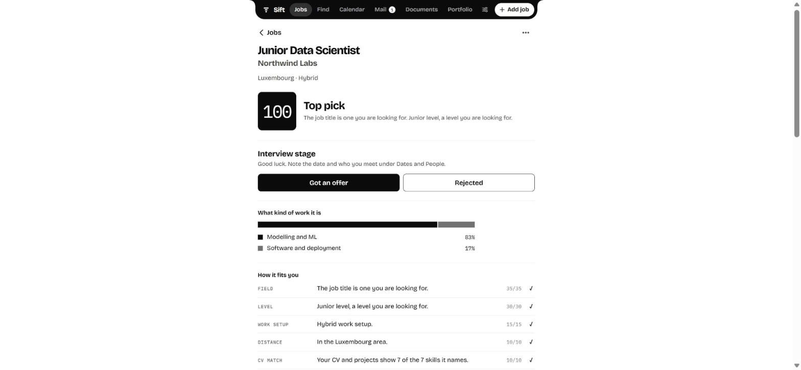
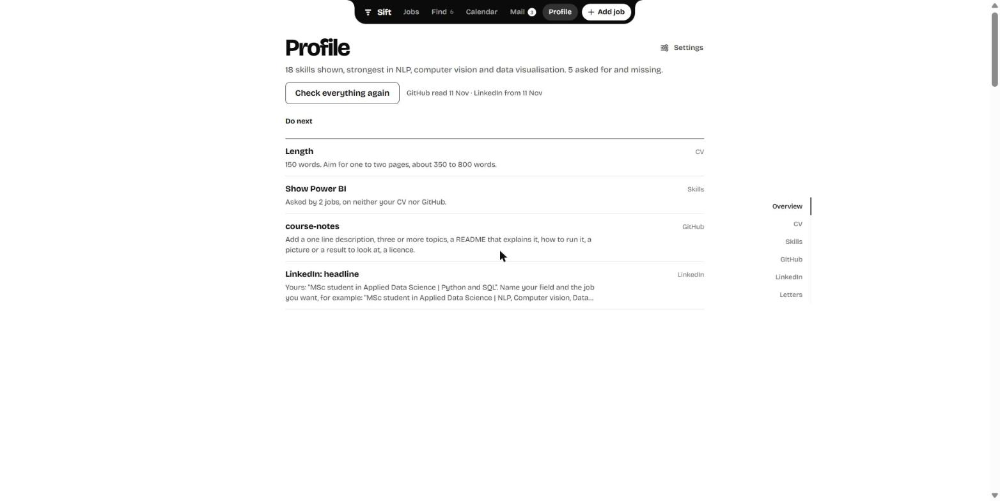
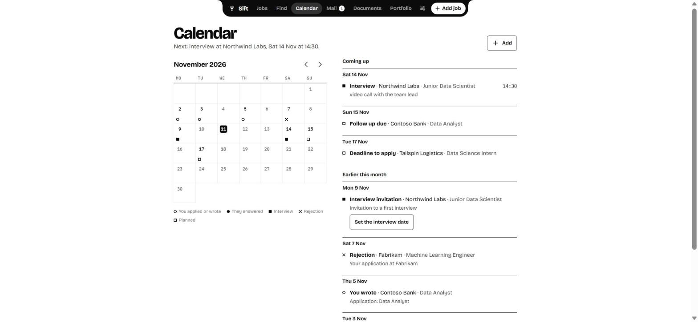

# Sift

Sift used to be called Shortlist: the repository, the Python package and the database file keep that name.

A job search app for you and the people who help you. Paste a link from LinkedIn, Indeed or any site, and Sift reads the posting and tells you how well it fits: the field, the level, the work setup, the distance from home, the languages, what you already have and what you would still need. It checks your CV, writes motivation letters, watches your job inbox for replies, and sends a notification to your phone when a company answers.



Your family gets their own account. They find a job, tap Paste, and it is in your list with its fit score. When you apply to a job they sent, they get a notification too.


## What it does

1. **Add a job in one tap.** One box takes a link, a whole list of links (for example an answer from Claude or a message from a friend), or the job description itself. The Paste button reads what you copied. From the iPhone share sheet it works through a small Shortcut, and on Android Sift is in the share menu once installed.
2. **Never the same job twice.** Links are reduced to the real posting, and a job with the same company and role is recognised. If the job is already there, nothing is added; if the new copy says more (for example the full text of a posting that was blocked before), the saved job gets better instead.
3. **Finds jobs for you.** Say which job titles you want, at which level and where. Sift asks seven job sites at once (LinkedIn, jobs.lu, ICTjob.lu, Jobfinder.lu, eFinancialCareers, Amazon's job site and EURES, the European portal that carries the vacancies of the national employment agencies), keeps each job once however many sites carry it, reads the best ones and lists what it found, best fit first, with the site each one came from. While the app runs it also searches by itself twice a day, and your phone hears about the new jobs that fit. Open one to see what the job is, then save it or skip it; a skipped job never comes back.
4. **What the job actually is.** Each job shows what you would do, taken from the posting itself, and what kind of work fills the day (modelling, reporting, data engineering, software, client work), so a "Data Scientist" who mostly builds dashboards is plain to see. Next to it: the years of experience and the degree it asks for, against your own.
5. **Where it is.** A map shows every job as a pin, next to the list. Each job shows the way from your home and how long it takes by car, by bike and on foot, with a link to bus and train times.
6. **Why it fits.** A score from 0 to 100 with one line per reason and its points, then the skills the posting asks for that your CV or your GitHub projects show, the ones you would still need, and the projects worth mentioning.
7. **Accounts for helpers.** Invite your mother, a friend or a partner with a link. They are signed in when they open it, can send jobs, see every job with its fit, and write you a note on a job. They do not see your settings, letters or mail.
8. **CV check.** Upload a PDF, Word file, LaTeX file or the zip Overleaf downloads. Every upload is checked for the basics recruiters look for: length, contact details, LinkedIn, clear sections, results in numbers, strong verbs, dates and named skills. A deep review by Claude (or your local model) scores the CV for the jobs you want and lists concrete fixes and missing keywords. Add your GitHub name under Profile and your public projects count as proof of skills too: Sift reads their descriptions, topics and READMEs.
9. **Letters.** Claude or a local Ollama model writes a draft from your CV and the posting, in English, French, German, Dutch or Luxembourgish. Revise it with one tap (shorter, more formal, more personal, fix grammar) or your own words; every version is kept. Download as Word.
10. **Company replies in the app.** Connect a Gmail inbox, read only. Replies, interview invitations and rejections appear in the Inbox and on the job, with the text of the mail, a Reply button and a link to open it in Gmail, and your phone gets a notification. Mails you sent to a company mark the job as applied.
11. **Reminders.** Marking a job as applied sets a follow up ten days later. Once a day you get one notification with the follow ups that are due and the deadlines in the next two days.
12. **People and timeline.** For each job: the recruiters and anyone you know there, and every email, call, reply and interview with its date.
13. **Calendar.** One month and one list for everything with a date: when you applied or wrote, when a company answered and what it said, interviews and calls you planned, follow ups and deadlines. Each kind has its own mark, by shape and not by colour. The people who help you see the same calendar, without the words of your mails. An interview is announced on your phone the day before and on the day.
14. **One place for each thing.** Mail holds every mail about your applications, sorted into replies, interviews, rejections and what you wrote. Profile holds everything about you. Settings holds what you are looking for, your family, your mailbox, and which notifications you want: a company answers, the search finds a job that fits, somebody sends you a job, the morning summary. A helper can be told when you apply, get an interview or an answer.
15. **Filter what was found.** On Find, a filter sits beside the list (a sheet on a phone): sliders for how long ago a job was posted, the pay per year and the distance from home, and choices for hybrid, remote or on site, job, internship or working student, full time or part time, and the site it came from. Each choice shows how many jobs it leaves. What a posting does not say stays unknown and never matches.
16. **Profile.** One screen for everything about you, one part per screenful: an overview with the few things worth doing next, then CV, skills, GitHub, LinkedIn and letters. Scrolling settles on a part, one turn of the wheel goes to the next, and a rail on the right shows where you are and takes you to any other part. Under Skills, every skill is on one line, with where it shows: on your CV, in how many GitHub projects, on LinkedIn, and how many of your saved and found jobs ask for it. The skills that jobs ask for and you do not show yet are named first. Each GitHub project is checked for what a recruiter looks for (a description, topics, a README that explains it, how to run it, a picture or result, a licence), the ones that need most first. LinkedIn is compared with your CV: headline, About, jobs and projects that are missing, skills, languages, numbers, the profile link. Sift never opens LinkedIn itself; you paste your profile or upload the PDF LinkedIn makes of it.
16. **One file.** Everything lives in `shortlist.db`, with a daily backup. Download a copy as JSON under Settings → Account; `POST /api/import/json` reads it back.

| Profile | Calendar |
| --- | --- |
|  |  |

The pictures show made up data. Build the same to look around without your own jobs: `python examples/demo.py demo.db`, then `python -m shortlist --db demo.db --port 8011 --no-backup --no-find --mail-every 0` and sign in as Alex with the password `demo demo`.

## Quick start on your computer

```bash
git clone https://github.com/YannKleees/shortlist.git
cd shortlist
./start.sh          # Windows: double click start.bat
```

The first run creates a virtual environment and installs everything. The app opens at http://127.0.0.1:8000 and asks for your name and a password: that is the owner account. Then upload your CV under Profile and add your first job.

**An icon in your taskbar.** Run `.venv\Scripts\python -m shortlist.launch --shortcut` once. It puts Sift in the Start menu and on the Desktop; right click it in Start and choose **Pin to taskbar**. One click then starts Sift quietly in the background (no black window) and opens it in its own app window. It keeps checking your mail after you close the window.

Forgot your password? `python -m shortlist --sign-in-link Yann` prints a one time sign in link.

## Put it online, so your family and your phone can use it

On your computer alone, Sift works fully, but your mother cannot reach it and your phone gets no notifications. Notifications on an iPhone also need a secure https address. Two ways:

**Free: from your own computer, with Tailscale Funnel.** Install [Tailscale](https://tailscale.com), sign in, and run `tailscale funnel --bg 8000` (the first time it gives you a link to switch Funnel on for your account). You get a fixed address like `https://laptop.tail1234.ts.net`. Put it in `.env` as `SHORTLIST_PUBLIC_URL`, restart, and invite people. It works whenever your computer is on and awake.

**Always on: Fly.io, about 3 to 4 euros a month.** A small server in Amsterdam keeps checking your mail and sends notifications while your computer is off. With the [Fly CLI](https://fly.io/docs/flyctl/install/):

```bash
fly launch --no-deploy --copy-config          # choose a unique app name
fly volumes create shortlist_data --size 1 --region ams
fly secrets set ANTHROPIC_API_KEY=sk-ant-... SHORTLIST_PUBLIC_URL=https://<your-app>.fly.dev
fly deploy
```

A server cannot run a local model, so online Sift writes letters with Claude. A letter costs a few cents. Move your data over with the copy from Settings → Account and `POST /api/import/json`.

### On the iPhone

1. Open your Sift address in Safari, tap Share, then **Add to Home Screen**. From then on it opens like an app.
2. Open it from the Home Screen, go to Settings, and turn on **Notifications**. iOS 16.4 or newer.
3. Optional, for one tap sharing from LinkedIn: make a Shortcut with one action, **Get Contents of URL**, that POSTs `{"text": Shortcut Input}` to your personal address (`GET /api/me` returns it as `shareUrl`). Turn on Show in Share Sheet.

### Inviting your family

Under You, Family and helpers, type their name and tap **Create invite link**, then **Send link** to share it on WhatsApp or by text. The link works once, for 14 days. If they get a new phone, tap **New link** next to their name.

## How the fit score works

A rule based extractor reads seniority, minimum years, field, work setup, job type and required languages from the title and the posting. The title decides the level first, so "mentoring from senior data scientists" does not make an internship senior. Years only count next to the word experience, and a language only counts as required when the posting asks for it and does not call it a plus. A list of about fifty named skills gives what you have and what you would need, and the share you have is the CV match. With a Claude key, Claude does the extraction instead.

| Part | Points | Highest when |
|---|---|---|
| Field | 35 | the job title is one you asked for |
| Level | 30 | a level you asked for, and no more years of experience than you have plus one |
| Work setup | 15 | the setup you prefer (hybrid when you have no preference) |
| Distance | 10 | up to 20 km from home, or remote |
| CV match | 10 | your CV and projects show every skill the posting names |

A required language you do not speak costs 15 points. A degree above yours (a PhD when you have a Master's) costs 10; a Master's that is asked for while yours is still running is shown, and costs nothing. Senior roles, and jobs that ask for three or more years beyond your own, are capped at 35.

What you asked for lives under Settings → What you are looking for: job titles, levels, work setup, where to search, your years of experience. Your degrees are read from the education lines of your CV. Changing any of it, or the CV, home or language list, updates every job; your own edits stay. Before you fill it in, the general weights in `shortlist/score.py` apply.

Finding jobs is `shortlist/discover.py`. Each site is one small function that takes a job title and a place and returns listings, so adding a site is adding one function to `SOURCES`. Every site is asked the way a visitor's browser asks it, without an account. A site that answers with a captcha or a login wall is not a source, and nothing in the code tries to get around one: that rules out Indeed, Monster, Moovijob and Glassdoor (Moovijob's vacancies still arrive through EURES). jobs.lu, ICTjob.lu and Jobfinder.lu are asked only when you search in Luxembourg; EURES, eFinancialCareers and Amazon for any country the code knows by name. LinkedIn's and eFinancialCareers' terms do not welcome automated reading, so the volume is kept to a handful of requests per search; leave them out of `SOURCES` if you would rather not.

What the job is comes from `shortlist/brief.py`, with plain rules and no model: the bullets under the heading that says what you do (in English, French or German), the kinds of work counted by the words the posting uses, and the sentence that names a degree.

## Configuration

Put these in `.env` (copied from `.env.example` on the first start), or set them on your host.

| Variable | Default | Purpose |
|---|---|---|
| `SHORTLIST_PUBLIC_URL` | none | the https address people use, for invite links and the share button |
| `ANTHROPIC_API_KEY` | none | Claude for letters, CV reviews and extraction; can also be set in the app |
| `SHORTLIST_LETTER_MODEL` | `claude-opus-5-5` | Claude model for letters and reviews |
| `OLLAMA_URL`, `OLLAMA_MODEL` | `http://localhost:11434`, `llama3.1:8b` | local model when there is no Claude key |
| `SHORTLIST_DB` | `shortlist.db` | database file |
| `SHORTLIST_BACKUPS` | `backups/` next to the database | daily copies, the newest 14 are kept |
| `SHORTLIST_MAIL_MINUTES` | `10` | minutes between mail checks, 0 for by hand only |

Start options: `--db`, `--port`, `--host`, `--no-browser`, `--no-backup`, `--mail-every`, `--sign-in-link NAME`.

### With Docker

`docker compose up -d --build` runs Sift and Ollama side by side on http://localhost:8000, with the database in the `shortlist-data` volume. Add `-f docker-compose.gpu.yml` for an NVIDIA GPU. `make backup` copies the database out.

## Security and privacy

Passwords are hashed with scrypt. Sessions and invite links are random tokens of which only a SHA-256 is stored, so a copy of the database cannot be used to sign in. The session cookie is HttpOnly, SameSite=Lax and Secure on https, and requests that change data from another site are refused. Ten wrong passwords from one address lock sign in from that address for ten minutes. Every page is sent with a content security policy (scripts only from the app itself), may not be framed by another site, and asks search engines not to list it, because the app can stand on the open internet. Helpers can only read jobs, add jobs and write notes.

`shortlist.db`, backups, exports, `.env` and CV files are in `.gitignore`. The outgoing requests are the job pages you add, the public job search of the seven sites listed under Find when you use it (one request per job title and site, a second apart, then the postings you open), a Wikipedia lookup for the company, OpenStreetMap for places, map tiles and travel times (Nominatim, tile.openstreetmap.org, routing.openstreetmap.de), your Gmail inbox over IMAP (read only), your public GitHub repositories if you add your name, Claude if you set a key, and the push services of Apple, Google and Mozilla for notifications. The Gmail app password and the Claude key stay in the database on your machine or server and are never shown again or exported.

## API

The app is a small JSON API that you can also script against; interactive docs are at `/docs`.

| Method and path | Purpose |
|---|---|
| `GET /api/auth/state`, `POST /api/auth/setup`, `/login`, `/logout`, `/join` | accounts and invitations |
| `GET, PUT /api/me` | your name and password, your share address |
| `GET /api/people`, `POST /api/people/invite`, `POST /api/people/{id}/link`, `DELETE /api/people/{id}` | helpers (owner) |
| `POST /api/jobs/add` | add anything pasted: a link, a list of links or a job text; says what was added, already there or improved |
| `POST /api/share?key=...` | the same for the iPhone share sheet, with a personal key instead of a sign in |
| `GET, POST /api/jobs`, `GET, PATCH, DELETE /api/jobs/{id}` | jobs |
| `POST /api/jobs/{id}/text`, `/notes`, `/contacts`, `/events`, `/letters` | job text, helper notes, people, timeline, letters |
| `GET /api/finds`, `POST /api/finds/search`, `POST /api/finds/{id}/read`, `/save`, `/skip` | jobs found for your profile: search, read one in full, save or skip it |
| `POST /api/cv`, `POST /api/cv/review` | upload and review your CV |
| `PUT /api/github`, `POST /api/github/refresh` | add your GitHub name, read your projects again |
| `POST /api/push/subscribe`, `/api/push/test` | notifications |
| `GET /api/portfolio`, `PUT /api/linkedin`, `POST /api/linkedin/file` | skills across CV, GitHub and LinkedIn; your LinkedIn profile as pasted text or PDF |
| `GET /api/calendar` | everything that happened or is planned, by day (helpers get it without mail text) |
| `GET /api/letters` | every letter, newest first |
| `GET /api/mails`, `POST /api/mails/seen` | the inbox: replies with their text, and what you have read |
| `POST /api/mail/check`, `PUT /api/settings`, `GET /api/export`, `POST /api/import/json` | mail, settings, moving data |

## Tests

```bash
pip install -e ".[dev]"
pytest -q        # accounts, permissions, adding and merging jobs, finding jobs, what a job is, notifications, CV review, letters, mail, scoring
npm test         # front end logic
ruff check .
```

GitHub Actions runs the linter, both test suites on Python 3.11 and 3.13, and builds and smoke tests the Docker image.

## Project structure

```
shortlist/
  server.py       FastAPI app: accounts, permissions, JSON API
  db.py           SQLite schema, migration, queries, accounts and sessions
  ingest.py       reading links, shared text and pasted postings
  scoring.py, score.py, extract.py, skills.py, similarity.py   fit score, reasons, have and need
  brief.py        what a job is: tasks, kinds of work, the degree asked against yours
  discover.py     finding jobs: the job sites it asks, telling the same job on two sites apart, and what was found, saved or skipped
  cvreview.py     CV checks and the deep review
  github.py       your public repositories and their READMEs
  portfolio.py    skills across CV, GitHub and LinkedIn, and the checks on each
  llm.py          Claude or Ollama
  letters.py      letter prompts and Word export
  push.py         Web Push notifications
  mail.py         read only Gmail: shared jobs, applications, replies
  launch.py       the taskbar icon: starts the server quietly and opens the app window
  geo.py          OpenStreetMap places, distances and routes
web/              the app: one page, plain JavaScript and CSS, a service worker for notifications
docs/             the older mail based helper page (still works)
fly.toml          always on hosting on Fly.io
```

## Design notes

The interface is built for a phone first and for people who do not like technology. Every button is at least 44 points tall, the main action sits in the thumb zone of the tab bar, and the layout respects the iPhone's safe areas. Colours are defined in OKLCH so light and dark mode keep the same contrast. Titles use Bricolage Grotesque (self hosted, SIL Open Font License) with a metric matched fallback, body text the system font, and numbers rounded tabular figures, so scores and counts never jiggle.

The look is black on white and nothing else: hairlines instead of boxes, weight instead of colour. How well a job fits shows in how full its score box is (solid, outlined, thin, dashed), and the kinds of work are one bar in shades of grey. The only colour is a red for errors and for deleting. Text is Bricolage Grotesque; numbers and small labels are IBM Plex Mono. The map is Leaflet (in `web/vendor`, BSD licence) on OpenStreetMap tiles in grey, so pins and routes stand out.

Motion has a job to do. Screens slide in the direction you move: deeper to the right, back to the left, tabs sideways in tab bar order, while the job's title and score glide from the list into the job page. The list switcher and every press spring a little. Each screen leads with the one thing to do next; details such as the reasons behind a score, dates and the timeline wait behind one tap. Sheets spring up from the bottom and can be pulled down, menus grow from the button that opened them, folds open with a real height animation, and applying for a job sets off a small burst of confetti. Everything is interruptible, uses only transform and opacity where it moves, and calms down when the phone asks for reduced motion.

## License

MIT
