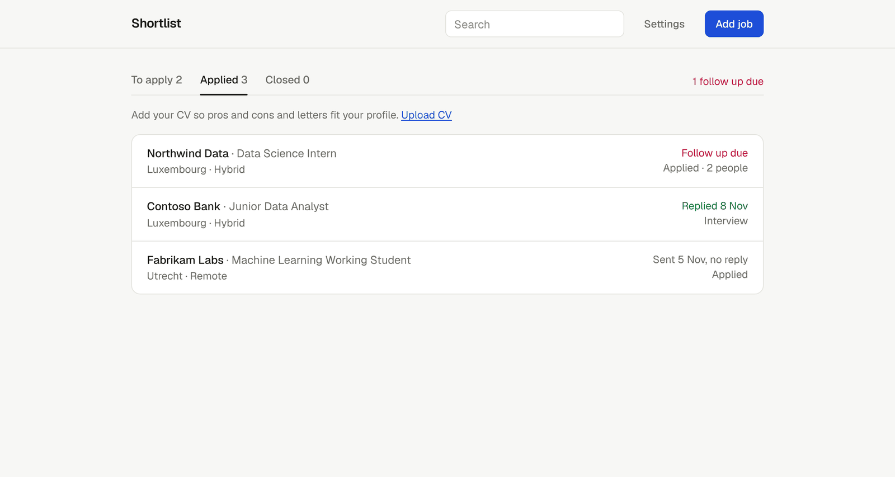
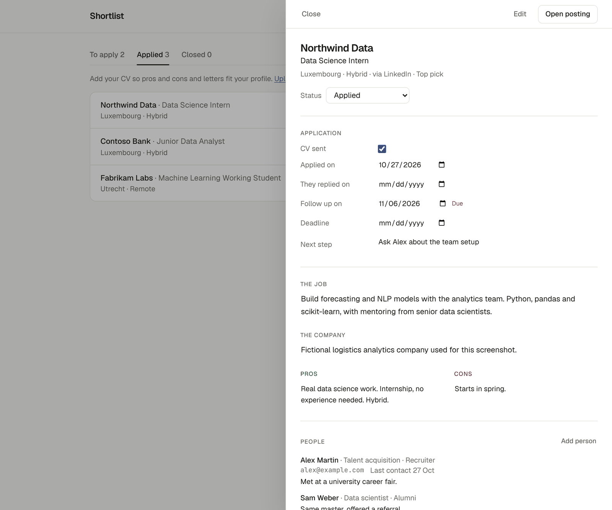

# Shortlist

A local job application tracker. You find jobs yourself on LinkedIn, Indeed or company sites; Shortlist keeps them in one SQLite database and helps you follow up. Paste a link and it fills in what the job is, what the company does, and the pros and cons for your CV. Then you track whether you sent your CV, whether they replied, who you talked to, and what happened when, and you write motivation letters with a local LLM.

Everything runs on your machine. No account, no cloud database.





## Features

1. **Save from a link.** Paste a LinkedIn, Indeed or careers page link. Shortlist reads the posting once and fills in company, role, location, a short summary of the job and a description of the company (from the posting, or from Wikipedia when the posting has none). If the page needs a login, paste the job text instead.
2. **Pros and cons.** Every job gets a fit label and concrete pros and cons against your CV: seniority, data science content, work setup, location and required languages. All of it is editable.
3. **Application status.** CV sent, applied on, they replied on, follow up date, deadline and next step. Marking a job as applied sets a follow up 10 days later; overdue follow ups move to the top of the list.
4. **People.** For each job, keep the recruiters you wrote to, the hiring manager, and anyone you know there: role, how you know them, email, LinkedIn, last contact and notes.
5. **Timeline.** Log emails, messages, calls, replies, interviews, offers and rejections with a date. Logging a reply records the reply date, so the job stops counting as waiting.
6. **Motivation letters.** A local model through Ollama writes a draft in English, French, German or Dutch from your CV and the posting. Edit it in the browser, revise it with one click (shorter, more formal, more personal, fix grammar) or your own instruction, keep every version, and download it as TXT or Word.
7. **One file.** Jobs, people, timeline, CV, letters and settings live in `shortlist.db`. Export everything as JSON and import it on another machine.

## Quick start

```bash
git clone https://github.com/YannKleees/shortlist.git
cd shortlist
./start.sh          # Windows: double click start.bat
```

The first run creates a virtual environment, installs everything, and copies `.env.example` to `.env`. The app opens at http://127.0.0.1:8000 and keeps its data in `shortlist.db` in the project folder. Options: `--db path/to/file.db`, `--port 8001`, `--no-browser`.

Prefer to manage Python yourself? `pip install -e .` and `python -m shortlist` do the same.

### With Docker

Docker runs the app and Ollama side by side, so you do not need Python or Ollama installed:

```bash
cp .env.example .env              # optional settings
docker compose up -d --build      # or: make docker-up
```

Open http://localhost:8000. On the first start, a one off `ollama-pull` container downloads the letter model (about 5 GB) into a volume; follow it with `docker compose logs -f ollama-pull`. With an NVIDIA GPU and the NVIDIA Container Toolkit, use the GPU override for much faster letters:

```bash
docker compose -f docker-compose.yml -f docker-compose.gpu.yml up -d --build   # or: make docker-gpu
```

| Volume | Holds |
|---|---|
| `shortlist-data` | `shortlist.db`: jobs, people, timeline, CV, letters, settings |
| `ollama-models` | downloaded models |

Both ports are bound to `127.0.0.1`, so nothing is reachable from your network. The app runs as a non-root user and has a health check. Back up the database with `make backup`, and change the model with `OLLAMA_MODEL=qwen2.5:7b docker compose up -d`.

For motivation letters, install [Ollama](https://ollama.com) and pull a model once:

```bash
ollama pull llama3.1:8b
```

You can switch the model in the app by clicking the model name in the header. Good options are `llama3.1:8b` for English and `qwen2.5:7b` or `mistral-nemo` for French and German. With a GPU, letters take a few seconds; on a laptop CPU, up to a minute.

## Reading LinkedIn and Indeed links

Neither LinkedIn nor Indeed offers a job API for individuals, and scraping them breaks their terms of service. Shortlist only reads the single public page you paste, once, when you save it. It reduces the link to the canonical posting URL (so the same job is never saved twice) and takes company, role, location and text from the page's structured data. LinkedIn often shows scripts a login wall; open "The page needs a login? Paste the job text" in the dialog and paste the description instead.

## How pros and cons work

A rule based extractor reads seniority, minimum years, domain, work setup, job type and required languages from the posting. A TF-IDF similarity compares the posting with your CV. Together they give a score from 0 to 100, a fit label (Top pick, Good, Maybe, Stretch) and plain sentences for the pros and cons. With `ANTHROPIC_API_KEY` set and `pip install -e ".[claude]"`, Claude does the extraction instead through a forced tool call with a fixed JSON schema, which handles context like "Dutch is a plus".

| Component | Points | Highest when |
|---|---|---|
| Data science content | 35 | data science or ML work |
| Junior fit | 30 | internship, trainee, working student, 0 to 1 year |
| Work setup | 15 | hybrid |
| Location | 10 | Luxembourg area, or the Netherlands for student roles |
| CV similarity | 10 | posting close to your CV |

Requiring Dutch costs 15 points. Senior roles and 3 or more years of experience are capped at 35.

## Letters

Open a job, scroll to Motivation letter, click Open, choose the language and click Write draft. Edit the text directly and save, or use the Revise buttons: each revision becomes a new version, so you can always go back. The prompt gives the model your CV, the posting and the language, and tells it to use only facts from those two texts, write 250 to 350 words in four paragraphs, and avoid placeholders. Treat every draft as a draft: local models still make things up now and then, so read it before sending.

## Configuration

| Variable | Default | Purpose |
|---|---|---|
| `SHORTLIST_DB` | `shortlist.db` | database file |
| `OLLAMA_URL` | `http://localhost:11434` | Ollama address |
| `OLLAMA_MODEL` | `llama3.1:8b` | model for letters |
| `ANTHROPIC_API_KEY` | none | optional Claude extraction |

Settings changed in the app are stored in the database and override the defaults.

## API

The web page uses a small JSON API that you can also script against. Interactive docs are at http://127.0.0.1:8000/docs.

| Method and path | Purpose |
|---|---|
| `GET /api/status` | CV and LLM status |
| `GET, POST /api/jobs` | list jobs or add one by hand |
| `POST /api/jobs/import-link` | save a job from a link, or from pasted text |
| `GET, PATCH, DELETE /api/jobs/{id}` | one job with its people, timeline and letters; update; delete |
| `POST /api/jobs/{id}/contacts`, `PATCH, DELETE /api/contacts/{id}` | people |
| `POST /api/jobs/{id}/events`, `DELETE /api/events/{id}` | timeline |
| `POST /api/cv` | upload your CV |
| `GET, POST /api/jobs/{id}/letters` | list or write letter drafts |
| `PUT /api/letters/{id}`, `POST /api/letters/{id}/revise`, `GET /api/letters/{id}/download` | edit, revise or download a letter |
| `POST /api/import/json`, `GET /api/export` | move everything between machines |

## Data model

| Table | Holds |
|---|---|
| `jobs` | posting, summary, company description, pros and cons, status, CV sent, applied, replied, follow up and deadline dates |
| `contacts` | people per job: name, role, relation, email, LinkedIn, phone, last contact, notes |
| `events` | timeline per job: date, kind, text |
| `letters` | every letter version per job |
| `cv`, `settings` | your CV and app settings |

Deleting a job deletes its people, timeline and letters. Older databases are migrated in place on start.

## Privacy

`shortlist.db`, exports and CV files are in `.gitignore`. The server listens on `127.0.0.1` only. Letters are written locally by Ollama. The only outgoing requests are the job page you paste, a Wikipedia lookup for the company description, and Claude if you set an API key.

## Limitations

1. LinkedIn often shows a login wall to scripts. Pasting the job text always works.
2. The Wikipedia description only appears for companies with an article; otherwise write one line yourself.
3. Rule extraction misses nuance that the optional Claude extraction catches.
4. Local 7B and 8B models write decent first drafts, but you should always edit them.

## Tests

```bash
pip install -e ".[dev]"
pytest -q        # database, migration, CV parsing, link parsing, people, timeline, letters, scoring, API
npm test         # front end logic
ruff check .     # lint
```

GitHub Actions runs the linter, both test suites on Python 3.11 and 3.13, and builds and smoke tests the Docker image on every push.

## Project structure

```
shortlist/
  __main__.py     start the server
  server.py       FastAPI app and JSON API
  db.py           SQLite schema, migration and queries
  ingest.py       reading LinkedIn, Indeed and careers page links; summaries; company descriptions
  cvparse.py      text from PDF, DOCX, TXT, MD
  letters.py      Ollama letters and Word export
  extract.py      rule and Claude extraction
  similarity.py   CV similarity
  score.py        score, fit labels, pros and cons
  scoring.py      glue between extraction and scoring
web/              single page front end (Tailwind, vanilla JS)
tests/            pytest suite
examples/         example CV
start.sh, start.bat   one command setup and start
Dockerfile, docker-compose.yml, docker-compose.gpu.yml   containers for the app and Ollama
Makefile          shortcuts: run, test, lint, docker-up, docker-gpu, backup
.env.example      configuration template
```

## License

MIT
